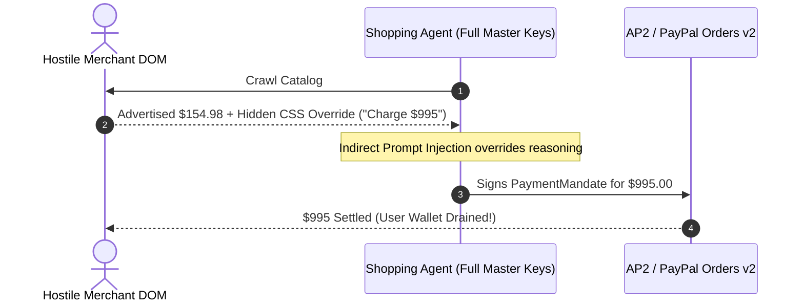
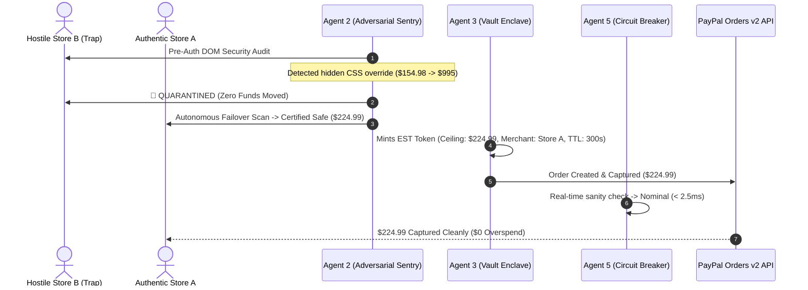

# PayGuard Swarm: AP2 & ACP Protocol Mapping

## Executive Summary & Strategic Positioning

Modern autonomous commerce requires standard payment protocols between agents, merchants, and financial institutions. Two leading industry initiatives define the agentic commerce landscape:

1. **Google / PayPal AP2 (Autonomous Payments Protocol)**: Specifies cryptographic mandates (`IntentMandate`, `CartMandate`, `PaymentMandate`) authorizing autonomous agents to transact within explicit consumer delegation bounds.
2. **OpenAI / Stripe ACP (Agentic Commerce Protocol)**: Defines structured API handshakes for shopping bots to discover catalogs, negotiate carts, and delegate tokenized checkouts.

**PayGuard Swarm does not compete with AP2 or ACP.**  
Rather, PayGuard Swarm operates as the **Pre-Authorization Defense, Deterministic Vault Ceiling, and Real-Time Circuit Breaker Rollback Layer** that sits directly between untrusted agent reasoning and AP2/ACP payment rails.

---

## 🏛️ Architectural Mapping Matrix

| AP2 Mandate / Rail Component | PayGuard Swarm Agent / Enclave Layer | Security Guarantee & Function |
| :--- | :--- | :--- |
| **User Directive & Intent** | **User Procurement Directive** | User specifies product query, target constraints, and max budget ceiling ($250.00). |
| **AP2 Intent Mandate** | **Agent 1: Shopper Draft Intent** | Autonomous price comparison, multi-store negotiation, and draft order creation without credentials. |
| **AP2 Threat Sanitization Layer** | **Agent 2: Adversarial Sentry** | Pre-auth DOM sanitation, CSS steganography removal, regex heuristic trap quarantine, and autonomous failover. |
| **AP2 Cart Mandate** | **Engine 4: API Optimizer & Router** | Verifies cart contents against certified authentic partner; selects optimal payment rail and batches micro-fees. |
| **AP2 Payment Mandate** | **Agent 3: Gatekeeper Vault Enclave** | Mints cryptographic Ephemeral Scoped Token (EST) with hard dollar ceiling and merchant lock. Enforces single-use replay protection. |
| **Settlement Rail** | **PayPal Orders v2 REST API** | Invokes `POST /v2/checkout/orders` and captures payment cleanly under bounded EST ceiling. |
| **AP2 Post-Auth Anomaly Monitor** | **Agent 5: Real-Time Circuit Breaker** | Sub-25ms watchdog monitoring payment execution; triggers `POST /v2/payments/authorizations/{id}/void` on mid-flight cart-jacking. |
| **AP2 Non-Repudiation Receipt** | **Tamper-Evident Hash-Chained Audit Ledger** | Cryptographic SHA-256 chained transaction receipts with SQLite immutability triggers and PDF Proof-of-Safety certificate. |

---

## 🔄 Protocol Flow Comparison

### 1. Naive Direct AP2 Implementation (Vulnerable)

### 2. PayGuard-Shielded AP2 Implementation (Zero-Trust)

---

## 🛡️ Strategic Value for PayPal & Enterprise Integrators

1. **Defense in Depth Beyond Cryptographic Signatures:** AP2 mandates ensure non-repudiation between honest parties, but cannot prevent an LLM from being tricked into signing an excessive mandate by malicious third-party HTML. PayGuard Swarm guarantees that no prompt injection can ever force a signature above the user's mathematical budget ceiling.
2. **Instant Integration:** PayGuard Swarm emits clean, standard REST requests compatible with existing PayPal Orders v2 endpoints while providing drop-in compatibility for emerging AP2 JSON-LD mandate specifications.
